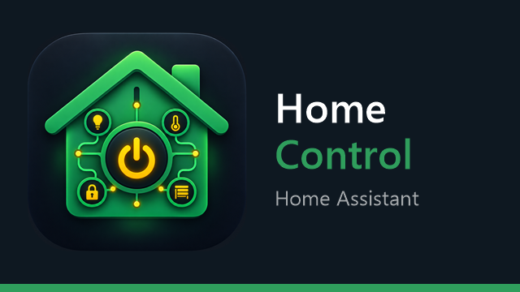
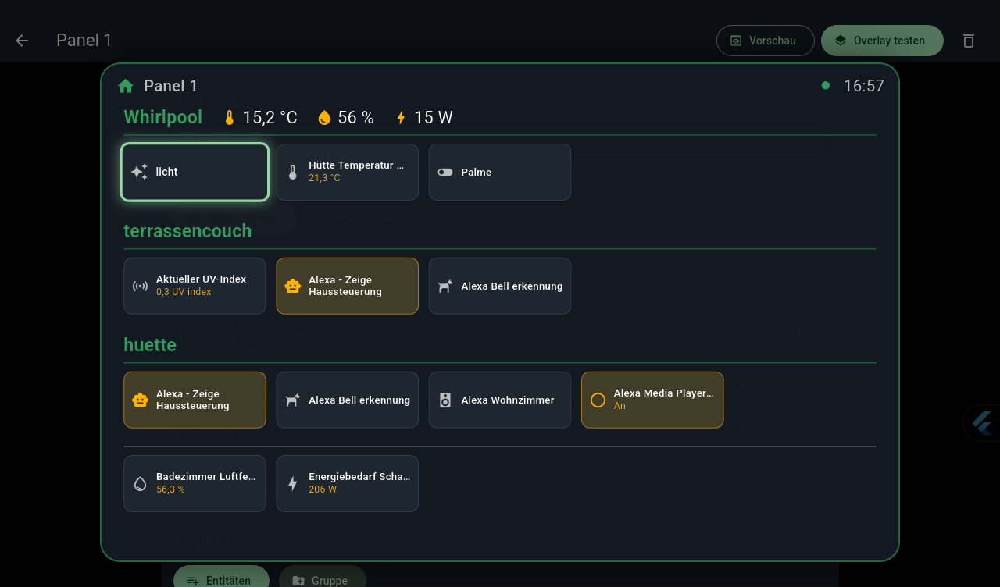
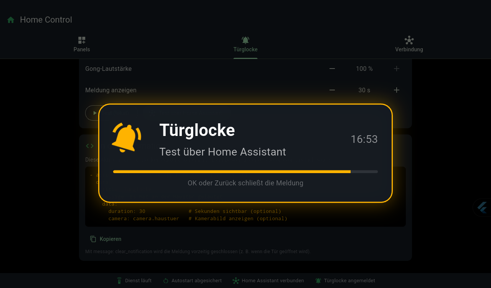
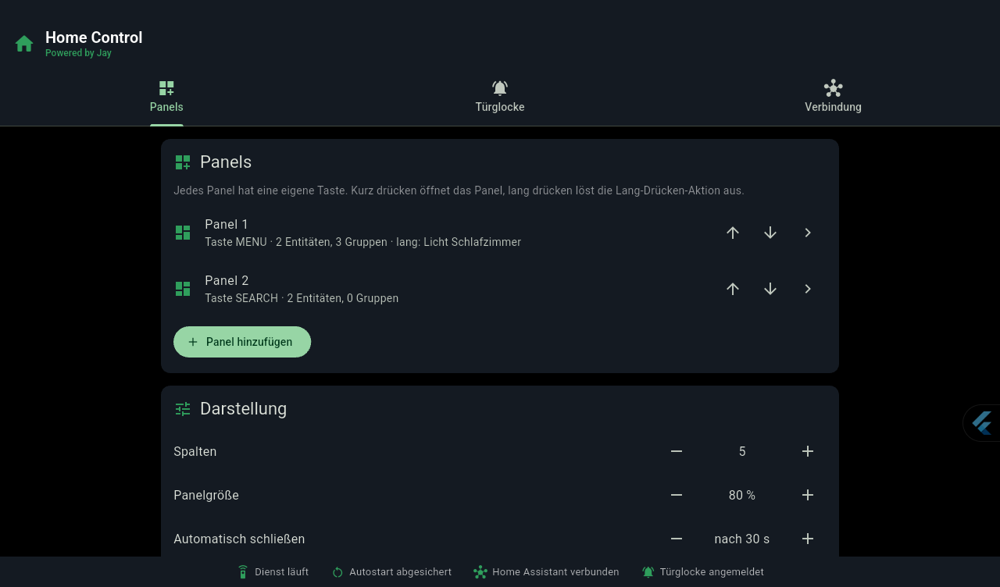

<p align="center">
  
</p>

<p align="center">
  <b>Home-Assistant-Schnellzugriff für Android TV</b><br>
  <a href="https://jaycloud.at/homecontrol">Powered by Jay</a> · Erklärseite: <a href="https://jaycloud.at/homecontrol">jaycloud.at/homecontrol</a>
</p>

Taste auf der Fernbedienung drücken: Über dem laufenden Bild (Film, Spotify, Radio …) erscheint ein Panel mit deinen
Home-Assistant-Geräten. Mit den Pfeiltasten auswählen, mit OK schalten, mit Zurück schließen. Das Video läuft dabei weiter.

Home Control ist als Ersatz für **QuickBars** entstanden, bei dem sich auf neueren Xiaomi-Boxen keine Tasten mehr anlernen
ließen. Dazu kommt eine **Türglocke**: Klingelt es, meldet Home Assistant das an die TV-Box. Dort ertönt ein Gong, die Musik
wird dabei nur kurz leiser, und die Meldung bleibt 30 Sekunden über allem stehen.

| Panel | Türglocke | Einstellungen |
| --- | --- | --- |
|  |  |  |

## Funktionen

### Panels

- **Mehrere Panels mit eigener Taste**: Jede freie Fernbedienungstaste (z. B. Menü, Suche, eine App-Taste) lässt sich anlernen.
- **Gruppen** wie „Whirlpool“, „Hütte“ oder „Terrassencouch“ erscheinen als Überschrift mit den Kacheln darunter. In der
  Überschrift stehen auf Wunsch **Temperatur, Luftfeuchte und Stromverbrauch**: *Whirlpool 🌡 35,0 °C 💧 58 % ⚡ 120 W*.
- **Flache Kacheln** mit Symbol und Name. Was an ist, leuchtet amber. Reine Anzeige-Entitäten (Sensoren) zeigen ihren Wert.
- **Eigene Namen und Symbole** je Entität. Symbole kommen aus den [Material Design Icons](https://pictogrammers.com/library/mdi/)
  wie in Home Assistant. Ein in HA gesetztes Symbol (`mdi:…`) wird automatisch übernommen.
- Schalten von Lichtern, Schaltern, Rollos, Ventilatoren, Klima, Media-Playern, Schlössern, Szenen, Skripten, Buttons, Saugrobotern …
- Spaltenzahl, Panelgröße (Standard 80 % des Bildschirms) und automatisches Schließen sind einstellbar.

### Lang drücken

Dieselbe Taste hat zwei Funktionen: **kurz** öffnet das Panel, **lang** löst eine Aktion aus, z. B. „Whirlpool-Pumpe aus“.
Nach 0,5 s erscheint *„Gedrückt halten … bis ‚Whirlpool-Pumpe‘ ausgeschaltet wird“* mit Fortschrittsring. Wer durchhält,
schaltet die Pumpe. Wer vorher loslässt, sieht *„Abgebrochen“*. Wählbar sind Umschalten, Ein oder Aus, die Haltedauer beträgt 1–6 s.

### Türglocke

Home Control meldet sich wie die Companion-App als Gerät in Home Assistant an. HA bekommt dadurch einen eigenen
Benachrichtigungsdienst. Ruft eine Automation ihn auf, passiert Folgendes:

- Die Meldung erscheint über allem, was gerade läuft: Glocke, Titel, Text, Uhrzeit und optional ein **Kamerabild**.
- Ein **Gong** ertönt. Die laufende Wiedergabe wird dafür nur kurz leiser („Ducking“) und läuft danach normal weiter.
- Die Meldung bleibt 30 Sekunden stehen (einstellbar). OK oder Zurück schließen sie.

Die Nachrichten kommen **lokal** über die bestehende Verbindung zu Home Assistant, eine Cloud ist nicht nötig.

### Hintergrunddienst

- Läuft ohne sichtbare App und startet nach einem Neustart von selbst.
- Hält die Verbindung zu Home Assistant dauerhaft offen. Das Panel zeigt deshalb sofort aktuelle Werte, und die Türglocke ist jederzeit empfangsbereit.
- Mit einer einmalig per adb erteilten Berechtigung schaltet sich der Dienst selbst wieder ein, falls Android ihn deaktiviert hat (siehe [Bekannte Grenzen](#bekannte-grenzen)).

### Einrichtung

- **Home Assistant suchen**: findet die Instanz im Netzwerk (mDNS und Netzwerk-Scan) und trägt IP und Port ein.
- **Einrichtung per Browser**: Token, Panels und Gruppen bequem am Handy oder PC eintragen, statt mit der Fernbedienung zu tippen.
- Einstellungen in drei Reitern (**Panels**, **Türglocke**, **Verbindung**). Unten zeigt eine Statusleiste immer, ob Dienst,
  Autostart, Home Assistant und Türglocke bereit sind.

## Voraussetzungen

- Android TV / Google TV oder ein Android-Tablet ab Android 7. Getestet auf Xiaomi Mi Box (Google TV, Android 14) und einem Android-Tablet.
- Home Assistant im lokalen Netz, erreichbar per `http://` oder `https://`.
- Für die Türglocke die Integration `mobile_app`. Sie ist in der Standard-Konfiguration (`default_config`) enthalten.
- Ein **Long-Lived Access Token** (Home Assistant → Profil → Sicherheit → Token erstellen).

## Installation

1. APK installieren, z. B. mit dem Deploy-Skript (siehe [Entwicklung](#entwicklung)) oder per
   `adb install -r app-release.apk`.
2. **Hintergrunddienst einschalten**: Einstellungen → Geräteeinstellungen → Bedienungshilfen → **Home Control Panel**.
   Fehlt der Eintrag, geht es auch per adb:

   ```sh
   adb shell settings put secure enabled_accessibility_services org.lotzapp.home_control/.PanelAccessibilityService
   adb shell settings put secure accessibility_enabled 1
   ```

3. **Autostart absichern** (empfohlen, einmalig):

   ```sh
   adb shell pm grant org.lotzapp.home_control android.permission.WRITE_SECURE_SETTINGS
   ```

   Das Deploy-Skript erledigt das automatisch.

Bedienungshilfe und Berechtigung werden nur gebraucht, um die Fernbedienungstasten abzufangen und das Panel einzublenden.
Die App liest **keine** Bildschirminhalte.

## Einrichten

1. App öffnen → Reiter **Verbindung** → **Suchen** (oder die URL eintragen, z. B. `http://192.168.1.10:8123`).
2. Den Token eintragen. Am bequemsten geht das mit **Einrichtung per Browser**: Die App zeigt eine Adresse wie
   `http://192.168.1.50:8765`, dort den Token am Handy einfügen.
3. Reiter **Panels** → **Panel hinzufügen** → **Taste anlernen** → die gewünschte Taste auf der Fernbedienung drücken.
4. **Entitäten** und **Gruppen** hinzufügen. In einer Gruppe Temperatur, Luftfeuchte und Stromverbrauch zuordnen.
   Ein Klick auf eine Entität öffnet die Anpassung von Name und Symbol.
5. Optional **Lang drücken**: Entität, Modus (Umschalten, Ein, Aus) und Haltedauer wählen.
6. Fertig: Die Taste öffnet ab jetzt überall das Panel. **Vorschau** und **Overlay testen** helfen beim Ausprobieren.

### Panels per Browser bearbeiten

Unter *Einrichtung per Browser* lassen sich alle Panels als Text bearbeiten:

```text
== Garten
-- Whirlpool
temperatur: sensor.whirlpool_temperatur
feuchte: sensor.whirlpool_luftfeuchte
leistung: sensor.whirlpool_leistung
switch.whirlpool_pumpe | Pumpe | mdi:pump
light.whirlpool_licht
--
-- Hütte
light.huette
--
scene.gartenparty
```

- `== Name` beginnt ein Panel, `-- Name` eine Gruppe, `--` allein beendet die Gruppe.
- `id | Name | mdi:symbol` setzt einen eigenen Namen bzw. ein eigenes Symbol.
- Taste und Lang-Drücken-Aktion stellt man in der TV-App ein. Sie bleiben erhalten, solange der Panelname gleich bleibt.

## Türglocke einrichten

1. Reiter **Türglocke** → Gerätenamen wählen (z. B. „Home Control Garten“) → **Bei Home Assistant anmelden**.
   Die App zeigt danach den Dienstnamen, z. B. `notify.mobile_app_home_control_garten`.
2. Die Aktion in die Türglocken-Automation einfügen, am besten als erste Aktion:

```yaml
actions:
  - action: notify.mobile_app_home_control_garten
    data:
      title: Türglocke
      message: Es hat an der Haustür geläutet
      data:
        duration: 30              # Sekunden sichtbar (optional, Standard aus der App)
        camera: camera.haustuer   # Kamerabild, alle 2 s aktualisiert (optional)
        chime: none               # Gong unterdrücken (optional)
  # … weitere Aktionen, z. B. das Lichtsignal
```

- `message: clear_notification` schließt die Meldung vorzeitig, z. B. wenn die Tür geöffnet wird.
- **Test (lokal)** und **Test über Home Assistant** im Reiter Türglocke prüfen Gong und Anzeige.
- Gong an oder aus, Anzahl Wiederholungen, Lautstärke und Anzeigedauer sind in der App einstellbar.

## Bedienung

| Taste | im Panel | in der Türglocken-Meldung |
| --- | --- | --- |
| ◀ ▲ ▼ ▶ | Kachel auswählen | – |
| OK | schalten | schließen |
| Zurück | Panel schließen | schließen |
| Panel-Taste | Panel schließen | schließen |
| Lautstärke | bleibt beim System | bleibt beim System |

## So funktioniert es

```text
Fernbedienung ──► PanelAccessibilityService (Kotlin, Bedienungshilfe mit Tastenfilter)
                    │  kurz/lang erkennen, Steuertasten weiterreichen
                    ▼
                 Flutter-Engine (vorgewärmt, als TYPE_ACCESSIBILITY_OVERLAY)
                    │  Panel · Halte-Popup · Türglocke
                    ▼
                 HaClient ──WebSocket──► Home Assistant
                    ├─ state_changed (Live-Werte)
                    ├─ call_service (Schalten)
                    └─ mobile_app/push_notification_channel (Türglocke)
```

- Das Overlay braucht **keine** Berechtigung „Über anderen Apps anzeigen“ und nimmt der laufenden App nicht den Fokus. Deshalb pausiert das Video nicht.
- Solange das Panel offen ist, fängt der Dienst die Steuertasten ab und gibt sie an Flutter weiter.
- Der Gong fordert Audio-Fokus `AUDIOFOCUS_GAIN_TRANSIENT_MAY_DUCK` an. Andere Apps werden vom System leiser gestellt statt gestoppt.

## Bekannte Grenzen

- **„Beenden erzwingen“** schaltet bei Android jede Bedienungshilfe ab. Mit der Autostart-Berechtigung schaltet Home Control
  den Dienst beim nächsten Öffnen der App selbst wieder ein. Ohne einmaliges Öffnen geht das nicht, das lässt Android nicht zu.
  Ein normaler Neustart ist dagegen kein Problem.
- Tasten, die Android selbst braucht (Home, Zurück, Steuerkreuz, OK), lassen sich nicht als Panel-Taste anlernen.
- Home Assistant liefert nur Symbole mit, die **von Hand** gesetzt wurden. Für alle anderen nimmt die App ein Standardsymbol je Gerätetyp.

## Entwicklung

```sh
flutter test
./scripts/deploy.ps1 -Release -All                    # bauen und auf alle adb-Geräte installieren
./scripts/deploy.ps1 -Release -Device MiTV            # nur Geräte, deren Name „MiTV“ enthält
./scripts/deploy.ps1 -Release -EnableService -Launch  # zusätzlich Dienst einschalten und App starten
```

Das Deploy-Skript erteilt bei jeder Installation die Autostart-Berechtigung. Release-Builds brauchen
`--no-tree-shake-icons`, weil die Symbole aus Home Assistant erst zur Laufzeit feststehen (das Skript setzt das automatisch):

```sh
flutter build apk --release --no-tree-shake-icons --split-per-abi
```

- `scripts/gen_icons.ps1` erzeugt App-Icon und TV-Banner.
- `scripts/gen_chime.ps1` erzeugt den Gong (synthetisch).
- In `android/gradle.properties` steht `kotlin.incremental=false`. Das ist nötig, wenn Projekt und Pub-Cache auf verschiedenen Laufwerken liegen.

### Projektstruktur

```text
android/app/src/main/kotlin/org/lotzapp/home_control/
  PanelAccessibilityService.kt  Tastenfilter, Overlay-Fenster, kurz/lang
  MainActivity.kt               Kanal zur App (Tasten anlernen, mDNS-Suche, …)
  Chime.kt                      Gong mit Audio-Ducking
  ServiceEnabler.kt, BootReceiver.kt   Dienst automatisch wieder einschalten
lib/
  main.dart                     Einstiegspunkte: App (main) und Overlay (overlayMain)
  core/                         Konfiguration, Theme, Kanal zu Android
  ha/                           WebSocket-Client, Entitäten, Symbole, Suche, mobile_app
  panel/                        Panel, Halte-Popup, Türglocke, Overlay-App
  settings/                     Einstellungen, Panel-/Gruppen-Editor, Browser-Einrichtung
assets/mdi/                     Material Design Icons (Font + Namensliste)
scripts/                        Deploy, Icons, Gong
test/
```

## Lizenz

[PolyForm Noncommercial 1.0.0](LICENSE.md). Der Quellcode ist offen einsehbar. Nutzung und Änderung sind für private und
nicht-kommerzielle Zwecke frei, auch für Vereine, Schulen und gemeinnützige Organisationen. **Kommerzielle Nutzung ist nicht
erlaubt**, z. B. Home Control zu verkaufen, als bezahlten Dienst anzubieten oder in kommerzielle Produkte einzubauen. Für eine
kommerzielle Lizenz bitte über GitHub anfragen.

Enthaltene Fremdinhalte: [Material Design Icons](https://pictogrammers.com/library/mdi/) (@mdi/font 7.4.47, Font unter
Apache 2.0, siehe [assets/mdi/LICENSE](assets/mdi/LICENSE)).

Home Assistant ist ein Projekt der [Open Home Foundation](https://www.openhomefoundation.org/). Home Control ist ein
unabhängiges Projekt und nicht mit Home Assistant verbunden.
